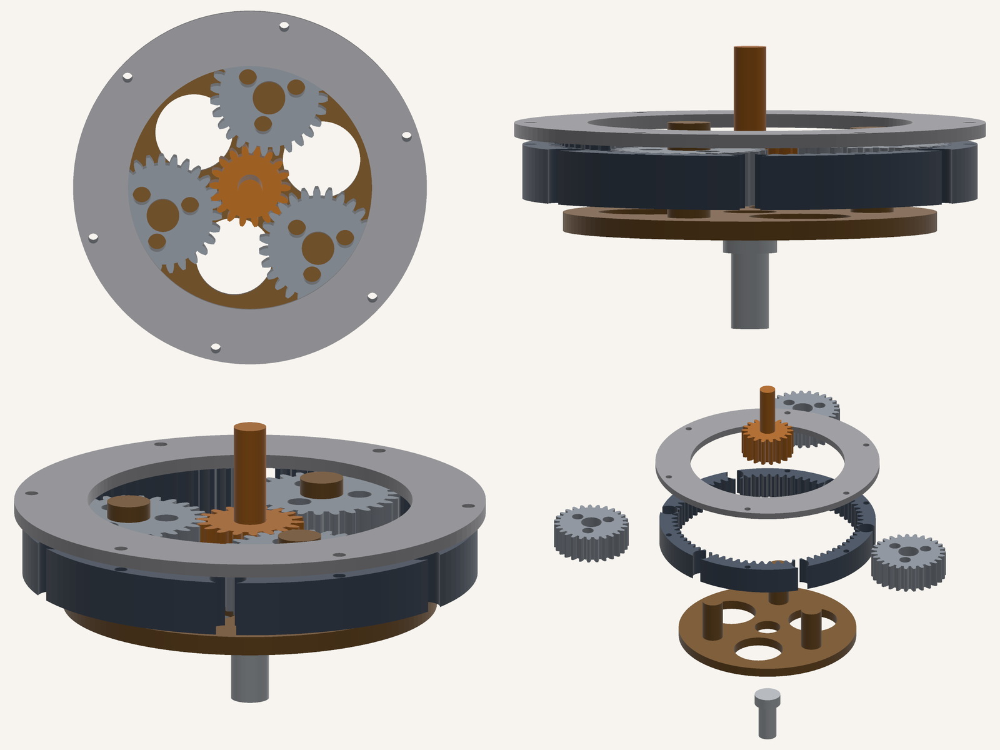
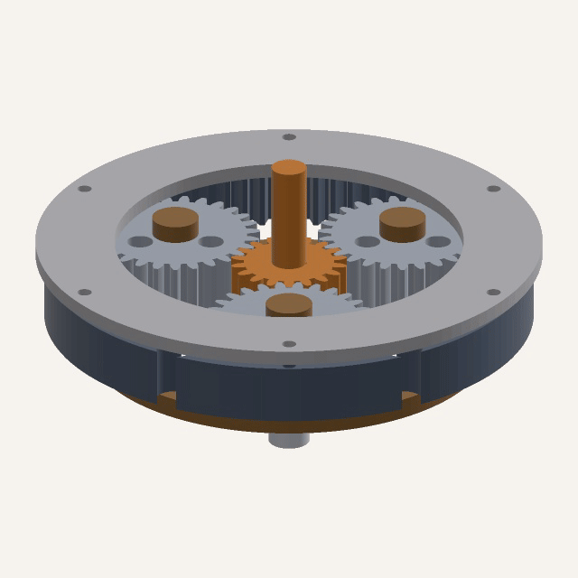
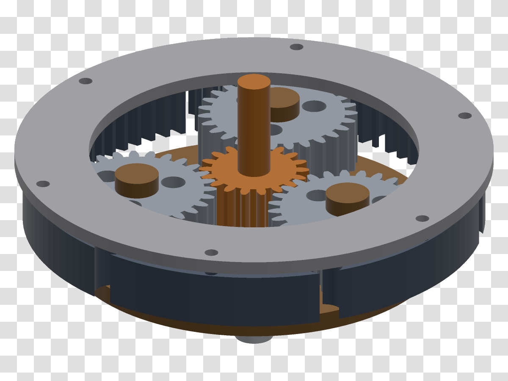

<div align="center">

# fcrender

**Render FreeCAD assemblies to transparent PNGs from a headless box.**
No OpenGL. No X11. No GUI. No display server.


<sub>A 56,518-triangle planetary reducer. Rendered on a machine with no GPU access, no display, inside WSL2.</sub>

</div>

---

## Why this exists

FreeCAD cannot save a picture without a GUI. Its renderer is Coin3D, which needs an
OpenGL context, which needs a display. The usual workaround is Xvfb plus Mesa's
software rasteriser — it works, but it drags a virtual display server and ~500 MB of
GUI stack into your container, and the output changes with the driver.

`fcrender` takes the other road. FreeCAD's own kernel still does the hard part
(B-Rep → triangles); the triangles are then rasterised by a numpy z-buffer in plain
Python. The only dependencies are `numpy` and `Pillow`.

Two consequences worth knowing up front:

- **`.FCStd` input needs FreeCAD installed.** You need its tessellator.
- **`.stl` input needs nothing but numpy.** If you do not have FreeCAD, export STL
  from whatever CAD you do have and this tool still works. Verified: the STL path
  runs in a clean venv where `import FreeCAD` fails.

## Install

```bash
git clone https://github.com/Orinkle/freecad-headless-render
cd freecad-headless-render
pip install -e .
```

That is the whole install. Pillow and numpy come with it.

### Pointing at FreeCAD (only for `.FCStd`)

FreeCAD's bindings are compiled against one specific Python — 3.11 for FreeCAD 1.1 —
and they will not load into any other interpreter. The failure looks like this:

```
ImportError: .../libFreeCADBase.so: undefined symbol: _Py_PackageContext
```

Do not fight it. Run `fcrender` with **FreeCAD's own interpreter** and put both
FreeCAD's `lib` and this checkout on `PYTHONPATH`:

```bash
FC=$CONDA_PREFIX            # or /usr/lib/freecad, or wherever FreeCAD lives

PYTHONPATH=$FC/lib:$FC/lib/python3.11/site-packages:$PWD \
  $FC/bin/python -m fcrender.cli examples/planetary-reducer.FCStd --views hero
```

No install step is needed for that form: `-m fcrender.cli` imports the package
straight out of the checkout, so FreeCAD's environment stays untouched.

If you already installed `fcrender` into FreeCAD's interpreter, the console script
works too:

```bash
PYTHONPATH=$FC/lib $FC/bin/fcrender examples/planetary-reducer.FCStd --views hero
```

Everything except `.FCStd` loading is pure numpy — the `.stl` path has no Python
version constraints at all.

## Quick start

```bash
# three views of a FreeCAD assembly, 1080p, 2x supersampled
fcrender examples/planetary-reducer.FCStd -o shots --views hero,top,side

# an STL, no FreeCAD anywhere in sight, cut out on transparency
fcrender examples/planetary-reducer.stl --bg none -o shots --views quarter

# exploded view + structured report
fcrender examples/planetary-reducer.FCStd \
  --explode Cover:0,0,95 --explode SunGear:0,0,130 --explode RingGear:0,0,52 \
  --views hero --report shots/report.json
```

Every view is fitted independently, so a part never falls outside the frame, and a
sequence of views keeps the same apparent scale.

## What comes out

<table>
<tr>
<td width="50%"></td>
<td valign="top">

**Named views, no camera maths required.**

`hero` · `low` · `top` · `side` · `quarter` · `front` · `iso` · `back`

Or supply your own: `--az-el 35,20`

**Per-part control.**

`--hide Cover,Bolt1` · `--only SunGear,PlanetGear_1` · `--explode Name:dx,dy,dz`

</td>
</tr>
</table>

<div align="center">

<br>
<sub>24 frames, 62 s total. Alpha is real, so it composites onto anything.</sub>
</div>

<table>
<tr>
<td width="50%"></td>
<td valign="middle">

`--bg none` writes a genuine alpha channel, not a background-coloured rectangle.
Anti-aliased edges keep fractional coverage, so the model drops onto a slide, a
poster, or a video timeline without a halo.

</td>
</tr>
</table>

## Command line

| Flag | Default | Meaning |
| --- | --- | --- |
| `input` | — | `.FCStd` (needs FreeCAD) or `.stl` (needs nothing) |
| `-o, --out` | `render` | Output directory |
| `--views` | `hero` | Comma-separated named views |
| `--az-el AZ,EL` | — | Ad-hoc camera, degrees; replaces `--views` |
| `--size WxH` | `1920x1080` | Image size |
| `--ss N` | `2` | Supersampling factor (N×N samples per pixel) |
| `--bg` | `F7F4EF` | Background hex, or `none` for transparency |
| `--palette` | `metal` | `metal` · `warm` · `blueprint` · `mono` |
| `--materials FILE` | — | JSON per-part material overrides |
| `--hide A,B` | — | Hide parts by name |
| `--only A,B` | — | Keep only these parts |
| `--explode NAME:DX,DY,DZ` | — | Offset a part; repeatable |
| `--cull` | off | Drop back faces. ~45 % faster, closed solids only |
| `--perspective` | off | Perspective camera (default is orthographic) |
| `--fov` | `32` | Vertical FOV, perspective only |
| `--pad` | `1.06` | Framing margin |
| `--exposure` | `1.05` | Lighting exposure |
| `--deflection` | `0.20` | Tessellation tolerance for `.FCStd` |
| `--jobs N` | `1` | Render N views in parallel (fork) |
| `--report FILE` | — | JSON report: paths, timings, triangle counts, bbox |
| `--prefix` | — | Filename prefix |

## Materials

FreeCAD opened headlessly has **no `ViewObject`**, so the colours saved in your
`.FCStd` file are unreachable — there is no scene graph to read them from. This is
the one place where the tool cannot do what a GUI would.

Materials are resolved in this order:

1. `--materials parts.json` — explicit, wins over everything
2. A name pattern — `SunGear` → accent, `RingGear` → body, `PlanetGear_2` → steel,
   `OutputShaft` → chrome, `Cover` → neutral, `Carrier` → warm
3. Round-robin through whatever roles the patterns did not claim

The pattern step exists so that `PlanetGear_1/2/3` stay the same colour. Round-robin
alone would paint three identical gears three different colours, which looks like a
mistake because it is one.

```json
{
  "SunGear":  { "color": "#c67a2e", "specular": 0.55, "shininess": 42 },
  "RingGear": { "color": "#2b3340", "specular": 0.60, "shininess": 55 }
}
```

Colours are sRGB; shading is done in linear space.

## Python API

```python
from fcrender import load, Scene, Camera, Lighting, render_view

scene = Scene.from_parts(load("gearbox.FCStd"), palette="metal")
scene.hide("Cover").explode({"SunGear": (0, 0, 120)})

render_view(
    scene,
    Camera.from_angles(azimuth=-49, elevation=28),
    "out/gearbox.png",
    width=2400, height=1600, ss=3,
    background=None,          # transparent
    lighting=Lighting(exposure=1.1),
)
```

`load()` returns `Part` objects (`name`, `tris`, `normals`), `Scene` handles
filtering and offsets, `Camera` is a direction plus projection, and `render_view`
ties them together. Individual stages — `project`, `shade`, `rasterize` — are
importable if you want to drive them from a frame loop.

## Performance

Measured on an i7-12650H (16 threads, WSL2), 56,518 triangles, output 1920×1080.
Wall time per view, FreeCAD load excluded:

| Setting | Time | vs. baseline |
| --- | --- | --- |
| `--ss 2` (default) | 4.7 s | 1.0× |
| `--ss 1` | 2.6 s | 1.8× |
| `--ss 2 --cull` | 2.6 s | 1.8× |
| `--ss 1 --cull` | 1.5 s | 3.1× |
| 5 views, `--jobs 5`, `--ss 2` | 6.7 s total | ~3× vs. serial |

The loop is per-triangle Python, so **triangle count drives the cost, not pixel
count** — dropping from 1080p to 540p saves far less than you would expect. If you
need speed, `--cull` is the honest win, and `--jobs` scales nearly linearly across
views.

`--deflection` is passed to FreeCAD's tessellator, but on already-faceted B-Rep
solids it often changes nothing at all. Measure before trusting it.

## Limits

Stated plainly, because discovering them the hard way wastes your afternoon:

- **Flat shading.** One normal per triangle. Faceted parts read as faceted by design;
  curved parts show their tessellation. No smooth normals.
- **No shadows, no ambient occlusion, no reflections, no refraction.**
- **No textures and no per-part transparency.** The alpha channel is for cutting the
  model out of the background, not for glass.
- **Orthographic by default.** `--perspective` exists, but orthographic is what
  engineering drawings want and it is the better-tested path.
- **Single-threaded rasteriser.** Numpy is doing the shading, but the inner loop is
  Python. Parallelism comes from rendering *views* in parallel, not one view faster.
- **`.stl` loses part identity.** A merged STL is one solid with one material. Use
  `.FCStd` if you want per-part colours and `--hide`/`--only`/`--explode`.

If you need real materials and lighting, use Blender. This tool exists for the
narrower job: a correct, dependency-light still image, on a machine that has no
business rendering anything.

## Built for agents

The design assumptions are unusual in a way that matters if a program is the caller:

- **Deterministic.** Same input, same bytes. No timestamps, no random dithering,
  no frame-dependent state.
- **Non-interactive by construction.** Nothing to click, no display to attach, no
  licence prompt. It runs in a container with no `DISPLAY` set.
- **Machine-readable results.** `--report out.json` returns paths, wall times,
  triangle counts, and the scene bounding box — enough for a caller to verify the
  job instead of just hoping.
- **Failures explain the fix.** A missing FreeCAD binding prints the exact
  `PYTHONPATH` to set and the STL fallback, rather than a bare `ImportError`.
- **Bounded surface.** Eight flags do the work. There is no config file to discover
  and no plugin system to learn.

## Provenance

Built by **DeepSeek-V4.1-Flash** on 2026-10-18, in one session, while producing a
technical explainer video about parametric CAD modelling. The renderer was not the
goal — the goal was frames for a video timeline, and every existing headless option
either needed a display server or a 300 MB renderer to draw a gearbox. So this was
written instead, validated against a real assembly, and then cleaned up into the
tool you are reading about.

The example model (`examples/planetary-reducer.FCStd`) is generated
parametrically: module 2, 18/27/72 teeth, pressure angle 20°, contact ratio 1.58,
ratio 5.0. Every dimension in it is derived, not drawn.

中文说明见 [README.zh-CN.md](README.zh-CN.md)。

## License

MIT. See [LICENSE](LICENSE).
