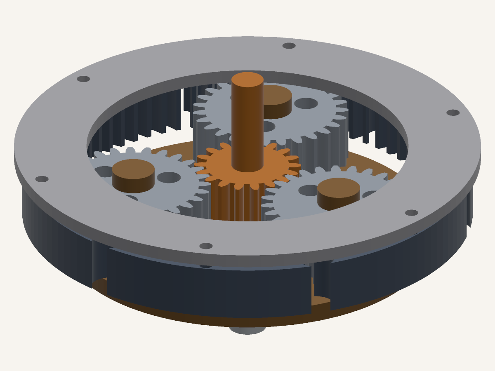

# fcrender — 无头渲染 FreeCAD 模型

把 FreeCAD 装配体渲染成**带透明通道的 PNG**，不碰 OpenGL、不需要 X11、不需要图形界面。



> 56,518 个三角面，在一台没有 GPU 访问权、没有显示器的 WSL2 机器上渲染完成。

## 为什么写这个

FreeCAD 的渲染器是 Coin3D，必须要有 OpenGL 上下文，也就是必须要有显示器。常见的绕法是
Xvfb 加 Mesa 软件光栅化——能用，但要往容器里塞一整个虚拟显示服务和约 500 MB 的 GUI 栈，
而且出图结果还跟驱动有关。

`fcrender` 换了一条路：让 FreeCAD 自己的内核做最难的部分（B-Rep → 三角面），然后用
numpy 的 z-buffer 在纯 Python 里光栅化。依赖只有 `numpy` 和 `Pillow`。

有两点要先说清楚：

- **输入 `.FCStd` 需要装 FreeCAD**（要用它的三角化器）。
- **输入 `.stl` 什么都不需要**，只要 numpy。没有 FreeCAD 的人，从任何 CAD 导出 STL 就能用。
  这条路径已实测：在一个 `import FreeCAD` 会失败的干净 venv 里跑通了。

## 安装

```bash
git clone https://github.com/Orinkle/freecad-headless-render
cd freecad-headless-render
pip install -e .
```

就这些。numpy 和 Pillow 会一起装上。

### 让 `.FCStd` 找到 FreeCAD

FreeCAD 的绑定是针对**某一个特定 Python 版本**编译的（FreeCAD 1.1 是 3.11），装不进别的
解释器。失败时长这样：

```
ImportError: .../libFreeCADBase.so: undefined symbol: _Py_PackageContext
```

别跟它较劲。用 **FreeCAD 自带的解释器**跑 `fcrender`，把 FreeCAD 的 `lib` 和本仓库一起
放进 `PYTHONPATH`：

```bash
FC=$CONDA_PREFIX            # 或 /usr/lib/freecad，或 FreeCAD 实际所在位置

PYTHONPATH=$FC/lib:$FC/lib/python3.11/site-packages:$PWD \
  $FC/bin/python -m fcrender.cli examples/planetary-reducer.FCStd --views hero
```

这种跑法不需要安装：`-m fcrender.cli` 直接从仓库导入，FreeCAD 的环境不会被改动。

## 快速开始

```bash
# 三个视角，1080p，2 倍超采样
fcrender examples/planetary-reducer.FCStd -o shots --views hero,top,side

# 一个 STL，全程不碰 FreeCAD，透明背景
fcrender examples/planetary-reducer.stl --bg none -o shots --views quarter

# 爆炸图 + 结构化报告
fcrender examples/planetary-reducer.FCStd \
  --explode Cover:0,0,95 --explode SunGear:0,0,130 --explode RingGear:0,0,52 \
  --views hero --report shots/report.json
```

每个视角单独取景，零件不会掉出画面；同一批视角之间的视觉大小保持一致。

## 输出能力

| 能力 | 用法 |
| --- | --- |
| 命名视角 | `--views hero,low,top,side,quarter,front,iso,back` |
| 自定义机位 | `--az-el 35,20` |
| 隐藏 / 只留 | `--hide Cover,Bolt1` · `--only SunGear,PlanetGear_1` |
| 爆炸图 | `--explode Cover:0,0,95`（可重复） |
| 透明背景 | `--bg none`（真 alpha 通道，边缘保留分数覆盖） |
| 正交 / 透视 | 默认正交；`--perspective --fov 32` |
| 配色 | `--palette metal\|warm\|blueprint\|mono`，或 `--materials parts.json` |
| 多视角并行 | `--jobs 5` |
| 结构化报告 | `--report out.json`（路径、耗时、面数、包围盒） |

## 材质：一处必须说明的限制

无头打开 FreeCAD 时**没有 `ViewObject`**，所以 `.FCStd` 里存的零件颜色读不到——没有场景图
可以读。这是本工具唯一做不到、而 GUI 能做到的事。

材质按以下顺序决定：

1. `--materials parts.json`——显式指定，优先级最高
2. 名称模式匹配——`SunGear`→暖铜、`RingGear`→深灰、`PlanetGear_2`→钢灰、
   `OutputShaft`→亮银、`Cover`→浅灰、`Carrier`→暖棕
3. 剩余零件在没被占用的角色里轮转分配

第 2 步存在的理由很实际：`PlanetGear_1/2/3` 是三个一样的齿轮，纯轮转会把它们涂成三种颜色，
看起来像 bug——因为它就是 bug。

## 性能

实测环境：i7-12650H（16 线程，WSL2），56,518 三角面，1920×1080 输出，不含 FreeCAD 加载时间：

| 配置 | 单视角耗时 | 相对基线 |
| --- | --- | --- |
| `--ss 2`（默认） | 4.7 s | 1.0× |
| `--ss 1` | 2.6 s | 1.8× |
| `--ss 2 --cull` | 2.6 s | 1.8× |
| `--ss 1 --cull` | 1.5 s | 3.1× |
| 5 视角 `--jobs 5` | 合计 6.7 s | 串行约 3× 加速 |

瓶颈是**逐三角面的 Python 循环**，不是像素填充——从 1080p 降到 540p 省下的时间远少于预期。
要快就用 `--cull`，要批量就用 `--jobs`。

`--deflection` 会传给 FreeCAD 的三角化器，但对已经是平面片的 B-Rep 实体经常毫无变化。
用之前先量。

## 已知局限

- **平面着色**：每面一个法向。曲面会露出三角化的棱，这是设计取舍，不是缺陷。
- **没有阴影、环境光遮蔽、反射、折射。**
- **不支持纹理，不支持逐零件透明**。alpha 通道用于把模型从背景里抠出来，不是做玻璃。
- **光栅化单线程**，并行靠同时渲染多个视角。
- **STL 丢失零件身份**：合并后的 STL 是一个整体、一种材质。要分零件配色和 `--hide`/`--only`/`--explode`，必须用 `.FCStd`。

需要真正的材质和光照请用 Blender。这个工具只解决一个更窄的问题：在根本没打算渲染的机器上，
出一张正确、依赖极少的静帧。

## 面向 agent 的设计

如果调用方是程序而不是人，下面几点才重要：

- **确定性**：同样的输入产出同样的字节。没有时间戳、没有随机抖动、没有依赖帧序的状态。
- **构造上就不可交互**：没有要点的按钮，没有要挂的显示器，没有许可证弹窗。容器里 `DISPLAY` 为空也照跑。
- **结果可读**：`--report out.json` 返回路径、耗时、面数、包围盒——调用方可以校验，而不是只能祈祷。
- **失败时给修法**：缺 FreeCAD 绑定会直接打印该设的 `PYTHONPATH` 和 STL 备选方案，不是甩一个 `ImportError`。
- **表面积小**：八个参数干完所有事。没有配置文件要发现，没有插件系统要学。

## 来历

由 **DeepSeek-V4.1-Flash** 于 2026-10-18 一次会话内构建，起因是要给一支参数化 CAD 建模的
技术解说视频出帧。渲染器本身不是目的——目的是给时间轴供货，而当时所有现成的无头方案要么需要
显示服务，要么为了画一个齿轮箱得请出 300 MB 的渲染器。于是写了这个，拿真实装配体验证，
再整理成你现在读到的工具。

示例模型 `examples/planetary-reducer.FCStd` 是参数化生成的：模数 2、齿数 18/27/72、
压力角 20°、重合度 1.58、传动比 5.0。里面每个尺寸都是算出来的，不是画出来的。

## 许可

MIT，见 [LICENSE](LICENSE)。
